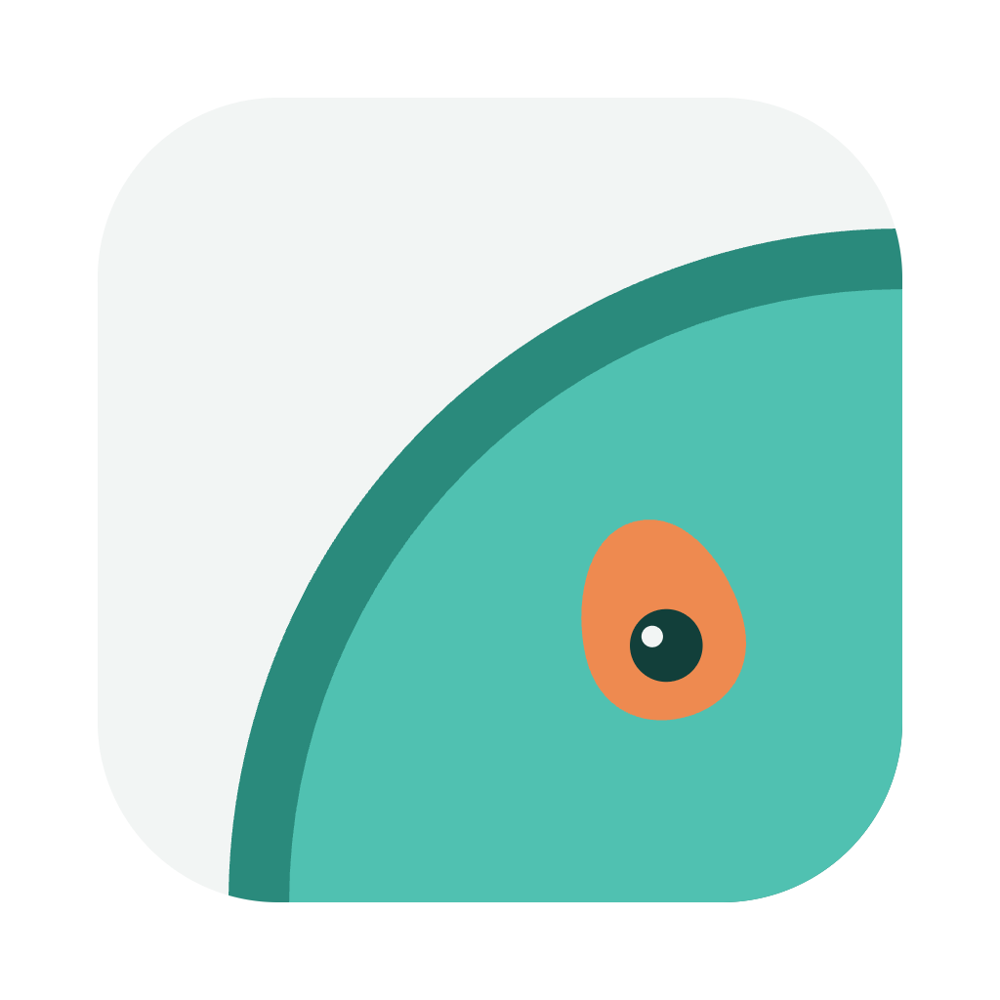

# Ghostbar



By Gus Dantas, [ghostavo.com](https://ghostavo.com).

One assistant for the Mac, the one I carry to every machine. It lives in the menu bar and does
the small jobs that otherwise take five separate apps:

- **Dictation in any app.** Hold a key and talk. A small panel shows the words as they come, and
  you can type into it while you speak. At each pause a second, more accurate model hears that
  stretch again and replaces it, unless you edited it. Enter pastes; ⌘Enter proofreads first.
  English and Portuguese, mixed if you like, all on the Mac.
- **Cast.** Screen or one window, with your face in a round bubble, 16:9 or 9:16 with a smooth
  crop you steer, a teleprompter, pause and resume. Recorded natively (ScreenCaptureKit, Core
  Image, AVAssetWriter), so the file is ready the moment you stop.
- **Screenshots** of an area, a window or the screen, straight to the clipboard, with a card in
  the corner to copy, edit, show in Finder, bin (with an undo) or drag into any app.
- **Text from the screen.** Drag over text and it is copied. A table pastes into Excel or Outlook
  as a table (Vision's document reader on macOS 26).
- **A library** of every capture and dictation, grouped by day, searchable by name, by the app it
  came from, by the text inside a screenshot and by what you said.
- **Mac switches:** keep Teams available while you are away (a one pixel nudge, only when idle),
  stay awake with the lid closed, and an optional VPN that exits in a country you pick.

Everything runs locally. Nothing leaves the Mac unless you add an Anthropic key for proofreading
(the dictated text is then sent to Claude) or set up the VPN (your own cloud server).

## Build it

You need macOS 15 or later on Apple silicon, Xcode, [Rust](https://rustup.rs) and
[Bun](https://bun.sh).

```bash
bun install
bun run tauri build
```

`scripts/install-mac.sh` builds, signs the app ad hoc with a requirement that keeps macOS's
privacy approvals across rebuilds, and installs it in /Applications.

On first launch macOS asks for the microphone, Accessibility (to paste), Screen Recording (for
screenshots and Cast) and the camera (for Cast's bubble).

## Set it up

- **Speech models.** Settings › Speech models. A streaming model gives the live text
  (Nemotron 3.5 ASR streaming); Cohere Transcribe, if downloaded, does the second pass.
- **Proofreading.** Add an Anthropic key in Settings › Dictation to proofread with Claude Haiku;
  without one, Apple Intelligence does it. The instructions are
  `src-tauri/src/proofread_prompt.txt`. To use your own, put a `proofread_prompt.txt` in
  `~/Library/Application Support/com.gusdantas.assistant/`. Custom Words are added as names to
  spell exactly.
- **Awake with the lid closed** needs a one time sudo rule that allows exactly
  `pmset -a disablesleep 0|1` and nothing else: `sudo ./scripts/install-lid-rule.sh`.
- **VPN** (optional) needs your own Google Cloud project, a Cloudflare zone and the WireGuard app.
  See [docs/vpn.md](docs/vpn.md).
- **Chrome.** A companion extension (separate) records tabs and full pages and shares the library
  through Chrome's native messaging. The app works without it.

## Look

The colours, type and mark follow [ghostavo.com](https://ghostavo.com). The mark is a single
tile: a quarter of a cut avocado (rind, light teal flesh) whose orange stone is also an eye, drawn
on a 100-unit grid. Teal marks the selection and the one main action, orange is only for a
recording, IBM Plex Mono is for small labels. Every version of the mark, the app icon and the menu
bar glyphs come from `design/mark/make_mark.py`.

## Credits

Speech runs on [transcribe.cpp](https://github.com/handy-computer/transcribe.cpp) and ggml; icons
are [Lucide](https://lucide.dev) (ISC); IBM Plex Mono is under the SIL Open Font Licence
(`src/assets/fonts/OFL.txt`).

## Shortcuts stop working (Secure Input)

While a password field or a terminal with Secure Keyboard Entry is focused, macOS hides key
presses from every other app, so the shortcuts pause. The menu bar icon shows a warning badge
while that lasts. Leave the password field, or turn off Secure Keyboard Entry in the terminal,
and the shortcuts come back.

Licence: MIT, see [LICENSE](LICENSE).
